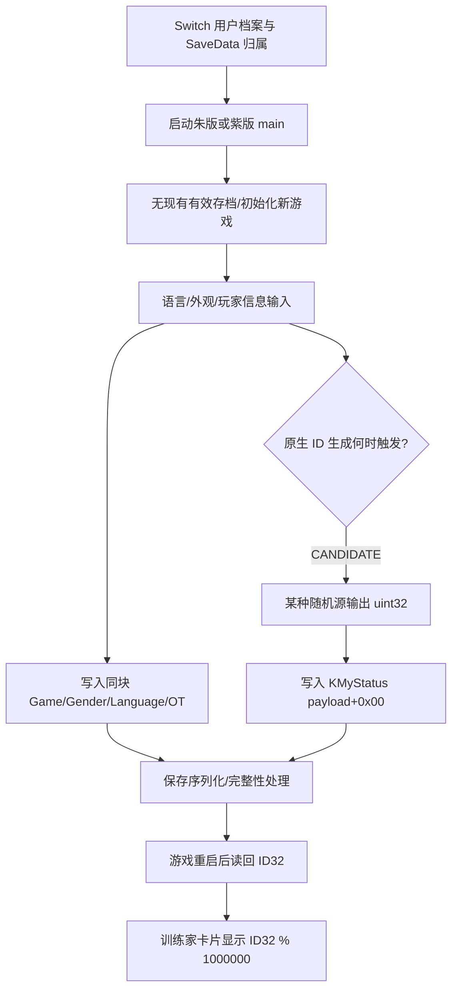

> [!important] R4 补充结论（2026-11-11；保留原整合文档历史记录）
> 之前标记为 UNKNOWN 的若干静态环节目前已恢复；以下是后来追加的原生证据：
> - `FUN_01B78D30`（Ghidra VA）= `main+0x01A78D30`：写入 `(DAT_04840AC0+0x40)` 中的 u32 ID32。
> - `FUN_01B78DA0` = `main+0x01A78DA0`：读取完整 ID32；`FUN_01B79160` = `main+0x01A79160`：计算 `ID32 % 1000000`。
> - 静态全局 `DAT_04840AC0` 对应 `main+0x04740AC0`，其中存放的是训练家对象指针，不是 ID32。
> - SysBot 4.0.0 的 `MyStatusPointer = [0x47350D8,0xD8,0x8,0xB8,0x0,0x40]` 提供另一条获取运行时 MyStatus 数据的指针路径。两条路线是否指向同一物理对象仍需运行时读回。
> - 朱/紫原版 ARM64 已确认 `FUN_0168D10C → FUN_0168D138(X0) → FUN_0168D238` 的 X0 传参和尾调用。
> - 真正新建 ID32 的 RNG、seed、setter 上层调用时机、保存 ACK 尚未验证。详见 [[sv400-sysbot-mystatus-pointers]] 与 [[sv400-trainer-id-initializer]]。
# 朱／紫 4.0.0：新建游戏的训练家 ID 生成及存档持久化（双 ELF）

> [!important] 证据等级
> **CONFIRMED**：ELF 来源、Ghidra 项目/反编译产物的存在与 SHA-256 标识；PKHeX 所实现的 Gen9 SV `MyStatus9` 存档字段布局；第七世代以来的六位 TID 显示规则。
> **CANDIDATE**：游戏原生“新建档案 → 设置玩家信息 → 生成随机 ID → 写入 KMyStatus”预期链路。
> **UNKNOWN / NOT_OBSERVED**：真正的 ID 抽取指令、PRNG 类型及初始 seed、真正的 AArch64 初始化调用栈、`MyStatus` 游戏运行时对象地址与管理器指针链、保存提交确认、不同版本原生实现是否完全相同。以下未经原始 ELF 对应指令支持的伪代码仅用于阐释字段和待验收关系，**不得作为原生反编译代码引用**。

## 1. 研究问题与三个相互独立的身份

1. **游戏内训练家 ID**：32 位 `ID32`，包含低 16 位 `TID16` 和高 16 位 `SID16`；玩家卡片显示的是十进制 `ID32 % 1_000_000`，不是直接显示 `TID16`。这是本文主要对象。
2. **Nintendo Switch 用户档案标识**：属于操作系统账户／保存数据归属范畴，通常由 Horizon OS 服务确定；不能将其视为 `MyStatus9.ID32`，也不能用 6 位训练家 ID 代替。当前并未证明朱紫 `main` 负责生成或修改它。
3. **Pokémon HOME / 联机服务的身份**：是另一个网络／应用层体系，不参与上文 `ID32` 的字段定义。不可从训练家卡片推断 HOME 用户 ID。

“新建账号”在游戏用户界面通常更准确地表述为“新建游戏存档／训练家”，不要混淆这三种概念。

## 2. 原始文件、版本与地址规范

| 版本 | 原始 NSO | 已发布原始 ELF | ELF 字节数 | ELF SHA-256 |
| --- | --- | --- | ---: | --- |
| 朱 Scarlet 4.0.0 | `4.0.0/0/scarlet_main` | `Unpack/4.0.0/exefs/scarlet_main/scarlet_main.elf` | 74,362,480 | `53776abb60a9d316b7b5365e0091cb7c971e62ffbf493e4541184f0d955aa79f` |
| 紫 Violet 4.0.0 | `4.0.0/0/violet_main` | `Unpack/4.0.0/exefs/violet_main/violet_main.elf` | 74,362,480 | `84e1e6c1ae3d4122eb736045cda82d075a189c718e9ba024a9fa90ee726f7d30` |

现有 Ghidra 12.2 项目：

- `Unpack/4.0.0/exefs/scarlet_main/ghidra12.2/{project,c,database,ndjson}`；已记录 97,877 个函数、97,871 个成功反编译。
- `Unpack/4.0.0/exefs/violet_main/ghidra12.2/{project,c,database,ndjson}`；两套各自独立，不得将朱版反汇编直接当作紫版的逐字节结论。
- 证据总索引：[[sv400-ghidra-12.2]]。原始分析输出不是任天堂源码，也不是运行时执行记录。

**地址表示**：Ghidra 采用 `IMAGE_BASE = 0x00100000`。只有对已经确认在 `main` 中的函数，且静态 RVA 计算与实际装载段映射相符时，才可写 `RVA = GhidraVA - 0x00100000`、运行时 `main + RVA`。另须分清 ELF *file offset*、*p_vaddr*、Ghidra VA 和运行时动态指针，四者不是同一个值。本文不会为 ID 生成函数虚构 `main+...`。

## 3. 已核实：存档中用户身份的持久化布局

2026-11-11 对照 `kwsch/PKHeX` 固定提交 `96e33e7432d900e5345afdfd117eabfac43f5bbd`：

- `PKHeX.Core/Saves/Access/SaveBlockAccessor9SV.cs`：`KMyStatus = 0xE3E89BD1`（训练家详情）；`KGameLanguage = 0x25839373`（`WSYS_LANGUAGE_SELECT`）；`KCurrentAppearance = 0x812FC3E3`（外观独立块）。
- `PKHeX.Core/Saves/Substructures/Gen9/SV/MyStatus9.cs`：以下**已解密 SCBlock 的 payload 相对偏移**，不是整个 `main` 存档文件偏移，更不是运行时静态全局指针。
- `PKHeX.Core/Saves/SAV9SV.cs`：游戏整体的 `ID32`、`TID16`、`SID16`、`OT`、`Gender`、`Language` 均转发至 `MyStatus`。

| 字段 | 所在 SCBlock | payload 偏移 | 类型 | 证据 / 解释 |
| --- | --- | --- | --- | --- |
| `ID32` | `0xE3E89BD1` | `+0x00..+0x03` | little-endian `u32` | 32 位训练家身份原值 |
| `TID16` | 同上 | `+0x00..+0x01` | `u16` | 低 16 位 |
| `SID16` | 同上 | `+0x02..+0x03` | `u16` | 高 16 位 |
| `Game` | 同上 | `+0x04` | `u8` | 游戏版本字段；不是玩家 ID |
| `Gender` | 同上 | `+0x05` | `u8` | 训练家性别 |
| `Language` | 同上 | `+0x07` | `u8` | 存档语言，和 runtime-language 编码不同 |
| `OT / Trainer Name` | 同上 | `+0x10..+0x29` | 26 字节 UTF-16LE 风格字符串区域 | 由 `StringConverter8` 读写，名字最大字符数另有约束 |
| `BirthMonth` | 同上 | `+0x5A` | `u8` | 生日月份 |
| `BirthDay` | 同上 | `+0x5B` | `u8` | 生日日期 |
| `RuntimeLanguageId` | `0x25839373` | SCBlock 原始值 | `int` | 设置 `Language` 时需做枚举映射，不可直接复制字节 |

**不要把字段偏移 `+0x00` 误写成绝对地址 `main+0x00`**：游戏运行时的保存块指针必须先由管理器或已观察到的查表返回值获得。也不能认为 `KMyStatus` 是内存地址；它只是 32 位 block key。

### 3.1 精确的字段读写伪代码（由 PKHeX 行为归纳，非 ELF 反编译）

```cpp
// 输入为已解密、且长度足够的 MyStatus9 payload 指针。
uint32_t read_id32(const uint8_t* status) {
    return read_u32_le(status + 0x00);
}
uint16_t read_tid16(const uint8_t* status) {
    return read_u16_le(status + 0x00);
}
uint16_t read_sid16(const uint8_t* status) {
    return read_u16_le(status + 0x02);
}
void set_id32(uint8_t* status, uint32_t id) {
    write_u32_le(status + 0x00, id);
}
// 状态块中不存在额外独立的“6 位 TID”整数槽位。
uint32_t trainer_card_tid6(const uint8_t* status) {
    return read_id32(status) % 1'000'000u;
}
```

### 3.2 十进制展示与 16 位内部 TID/SID

设 `x = ID32`（`0 ≤ x ≤ 0xFFFFFFFF`）：

```text
TID16       = x & 0xFFFF
SID16       = (x >> 16) & 0xFFFF
TrainerTID7 = x % 1,000,000       // 卡片六位，左侧补零
TrainerSID7 = x / 1,000,000       // PKHeX 便于阅读的十进制高位
```

例如 `ID32 = 0x12345678 = 305419896`：`TID16 = 0x5678 = 22136`，`SID16 = 0x1234 = 4660`，训练家卡片显示 `419896`，十进制辅助 SID 为 `305`。不能把 `TID16=22136` 误判为游戏卡片显示结果。**除非经 ELF 验证，这个余数计算也不代表已经定位到卡片 UI 的具体函数地址**。

## 4. 从“新建存档”到 ID 的功能链：已知接口与缺口



上图连接关系中的创建事件、随机源类型、随机值写回的确切时点以及 ACK 分支均为 **CANDIDATE**。唯一可确认的事实是“完成的游戏存档通过已知块承载身份数据”；尚未证明每个箭头在 ELF 中对应哪条函数调用或它们的执行先后。

## 4.1 已恢复的原生 KMyStatus 保存块处理函数（朱紫两版）

定向扫描在朱、紫两版各发现两个以字面量 `0xE3E89BD1` 操作保存块的 Ghidra C 函数：

- `FUN_0168D238` / `main+0x0158D238`：设置 `param_1+0x9E=3`，读取全局 `PTR_DAT_047D4CA0`，`FUN_00F844F4` 返回容器指针，使用容器 `+0x80` 互斥锁，`+0x08/+0x10` 区间按 Key 查找；缺失路径调用 `FUN_015D0CB8(...,0x6D)`，并以 `param_1+0x40` 和长度 `0x68` 调用 `FUN_015D05BC`。
- `FUN_020F8D00` / `main+0x01FF8D00`：同样的 Key 和容器索引；出现容器 `+0x60` 的虚表 `+0x28/+0x50` 间接调用，并调用 `FUN_00F88478(...,param_1+0x40,0x68)`。

这两处确立了“保存块 HashDB 处理”的静态锚点，但不直接证明哪个函数生成 ID32。**CANDIDATE**：`0x6D-0x68=5` 可能是记录头长度，仍要检查具体结构。

原始反编译：

- [Scarlet FUN_0168D238](../../Unpack/4.0.0/exefs/scarlet_main/ghidra12.2/c/0168d238.c) / [Violet FUN_0168D238](../../Unpack/4.0.0/exefs/violet_main/ghidra12.2/c/0168d238.c)
- [Scarlet FUN_020F8D00](../../Unpack/4.0.0/exefs/scarlet_main/ghidra12.2/c/020f8d00.c) / [Violet FUN_020F8D00](../../Unpack/4.0.0/exefs/violet_main/ghidra12.2/c/020f8d00.c)

```c
// Ghidra C 原文节选：FUN_0168D238
lVar11 = FUN_00f844f4(uVar10,&local_158);  // 容器对象候选
pMVar1 = (MutexType *)(lVar11 + 0x80);   // 容器互斥锁
local_160[0] = 0xe3e89bd1;                 // KMyStatus Key
puVar5 = *(uint **)(lVar11 + 0x10);        // 索引结束地址候选
puVar13 = *(uint **)(lVar11 + 8);          // 索引起始地址候选
if (*puVar16 == local_160[0]) goto LAB_0168d344; // Key 比较
FUN_015d0cb8(&local_88,lVar11,local_160,0x6d); // 缺失路径
uVar15 = FUN_015d05bc(&local_e0,param_1 + 0x40,0x68); // 数据处理
```

```c
// Ghidra C 原文节选：FUN_020F8D00
local_38[0] = 0xe3e89bd1;                         // KMyStatus
plVar10 = *(long **)(lVar9 + 0x60);              // 回调对象
(**(code **)(*plVar10 + 0x28))(plVar10,local_38); // 虚调用
cVar6 = FUN_00f88478(&local_c0,param_1 + 0x40,0x68); // 源数据
(**(code **)(*plVar10 + 0x50))(plVar10,local_38); // 另一虚调用
```

## 5. 原生 ELF 逐行注释：证据准入标准

当前仓库保留 13,617,357 条朱版 Ghidra 指令、5,990,477 条交叉引用及分函数伪代码，能进行定点定位。**没有从原始 ELF 实证获得的 `BL/STR/MOVZ/MOVK/ADRP` 指令不应伪造为朱紫代码。**因此下述为分析时要建立的代码链，不是已确认反汇编：

```text
[UNKNOWN] 主线新建存档入口
  └─ [UNKNOWN] MyStatus/PlayerStatus 分配或取块
       ├─ [UNKNOWN] PRNG 初始化和 uint32 抽样
       ├─ [UNKNOWN] 把 Wn 中 ID 写到 MyStatus+0
       ├─ [UNKNOWN] 设置 0x04 Game、0x05 Gender、0x07 Language、0x10 OT
       └─ [UNKNOWN] 提交 SCBlock 及保存结果
```

找到候选后必须在**朱和紫各自**记录：Ghidra VA、ELF RVA、ELF 原始四字节指令、AArch64 反汇编、寄存器生存区间、参数 ABI（`X0..X7`）、上下层函数 `BL` 调用及传入的 SCBlock 指针对象身份，最后核实调用来自“新存档”而非“读取档案/调试/联机/图鉴”。完整逐行注释应以指令原文为行、右侧中文注释，并附带编译器无关的 C 伪代码，不要反向根据想要的逻辑编造汇编。

## 6. 定向静态扫描与复现

避免重新运行全量 Ghidra；用已发布的 `c/*.c`、可编辑项目和二进制只读研究：

```bash
sha256sum Unpack/4.0.0/exefs/{scarlet_main/scarlet_main,violet_main/violet_main}.elf
python3 scripts/Trace-SV400-TrainerID.py . scarlet_main
python3 scripts/Trace-SV400-TrainerID.py . violet_main
```

该脚本定位 `KMyStatus` 的 32 位原始常量、ARM64 `MOVZ/MOVK` 半字模式、`1000000` 的数据显示常量，以及 Ghidra C 中与它们相关的函数。**匹配到常量只证明字节/符号出现，未必证明函数负责生成 ID**。如果匹配是存档 `GetBlock` 读取器，需进一步沿调用关系回溯“新建存档”入口，并确认 `STR Wn,[Xstatus]` 的真正写入点。

建议下一步从对应 Ghidra SQLite 的 `instructions`、`references_full`、`defined_data`、`decompilation` 表取证，记录 `[PC-16,PC+32]` 精确指令窗及邻接调用图；数据库的精确恢复脚本是 `tools/ghidra/sv/sv400_restore_split.py`，且恢复前需按清单校验全部分片。不要把 ELF 文件偏移直接当 `main+` 地址。

## 7. 只读运行时验证标准

1. 准备两个可删除/备份的测试存档；首次创建与重启读回分开，避免覆盖真实用户资料。
2. 观察真实 `KMyStatus` 查表成功时的返回对象、payload 地址和 `+0x00` 值；只读记录数据，不主动改写生成结果。
3. 对真实 ID32 的唯一写入点记录 `PC/LR/X0..X7/Wt`、线程、返回值，判断写入发生在名字确认前还是后。
4. 如追踪随机源，记录调用前后 RNG 状态且把它与 ID32 字节相等关系建立；直到有实证前不要贴 `Xoroshiro/MT/SplitMix/OS RNG` 标签。
5. 游戏保存、进程退出、重新打开，三次只读对账 `KMyStatus+0x00` 与卡片六位数字；验证失败/取消创建是否会保留 ID。
6. 朱/紫分别重复、比对调用图及函数机器码哈希；单次运行命中不能证明所有创建路径。

## 8. 未闭合问题与结论

- `UNKNOWN`：ID32 是否由游戏 PRNG、系统熵或其它状态派生？是否有重新抽取、排除特殊值、测试初始种子等分支？
- `UNKNOWN`：真正负责 `ID32` 初始化的朱版/紫版原生函数入口、`BL` 调用者及运行时地址。
- `UNKNOWN`：初始训练家数据写入与保存任务 ACK 的确切顺序，及取消新建是否回滚。
- `UNKNOWN`：新建档案是否受 Switch 用户配置独立影响；不能从两个 ELF 推断服务器分配任何账号标识。

**阶段性结论**：当前能准确解释“训练家 ID 以哪种 32 位结构存放、与性别/语言/姓名的相对位置、六位卡片 ID 怎样从原值计算”；尚不能据此声称已恢复“游戏如何产生这 32 位随机值”的完整原生实现。后者必须由双 ELF 对应汇编和运行时证据闭环。

## 9. 固定外部参考与内部关联

- [PKHeX — `SaveBlockAccessor9SV.cs`（固定提交）](https://github.com/kwsch/PKHeX/blob/96e33e7432d900e5345afdfd117eabfac43f5bbd/PKHeX.Core/Saves/Access/SaveBlockAccessor9SV.cs)
- [PKHeX — `MyStatus9.cs`（固定提交）](https://github.com/kwsch/PKHeX/blob/96e33e7432d900e5345afdfd117eabfac43f5bbd/PKHeX.Core/Saves/Substructures/Gen9/SV/MyStatus9.cs)
- [PKHeX — `SAV9SV.cs`（固定提交）](https://github.com/kwsch/PKHeX/blob/96e33e7432d900e5345afdfd117eabfac43f5bbd/PKHeX.Core/Saves/SAV9SV.cs)
- [Project Pokémon — 32 位 Trainer ID 与第七代以后六位显示说明](https://projectpokemon.org/home/forums/topic/65002-confused-by-4-digit-sid-field-for-gen-7-tid-values-in-pkhex/)
- [[sv400-ghidra-12.2]] — 双版本 ELF/Ghidra 12.2 证据与恢复步骤
- [[sv400-haxe-r17-native-registration-guest-call]] — 区分静态原生与实机 guest 证据的惯例

---

## 附录 A：2026-11-11 双 ELF 原生新增证据（R2）

> 本附录使用原版 Scarlet/Violet ELF 的 SHA 校验和 Capstone 5.0.6 指令解码；两份原版在下列函数窗口均为相同指令字节。完整日志：[Actions #42951004888](https://github.com/969981/SV_Resources/actions/runs/42951004888)。**以下左列均为 main RVA**；Ghidra VA 要加 `0x100000`，而可执行 PT_LOAD ELF file offset 要加 `0x8D8`。

### A.1 `KMyStatus` 构造指令及文件偏移

| 位点 | ELF 文件偏移 | ELF/main RVA | Ghidra VA |
|---|---|---|---|
| `FUN_0168D238` Key 构造 | `0x158DB98` | `0x158D2C0` | `0x168D2C0` |
| `FUN_020F8D00` Key 构造 | `0x1FF9654` | `0x1FF8D7C` | `0x20F8D7C` |

```asm
; 第一段：FUN_0168D238，朱紫两版原始机器码一致
0158D2B4 90dce397  BL   0xE844F4            ; 解析数据容器，返回 X0
0158D2B8 13000291  ADD  X19,X0,#0x80        ; X19=容器+0x80 mutex
0158D2BC f40300aa  MOV  X20,X0              ; X20=容器指针
0158D2C0 287a9352  MOV  W8,#0x9BD1          ; 保存块 Key 低16位
0158D2C4 087dbc72  MOVK W8,#0xE3E8,LSL#16  ; W8=0xE3E89BD1
0158D2C8 e80300b9  STR  W8,[SP]            ; 将 Key 放在栈，**非 ID32 写入**
0158D2CC e00313aa  MOV  X0,X19              ; 传入 mutex
0158D2D0 1cbc7a94  BL   0x343C340           ; 加锁
0158D2D4 88820291  ADD  X8,X20,#0xA0        ; 模式标志字段
0158D2D8 08fddf08  LDARB W8,[X8]           ; 读取状态位
0158D2DC a8150037  TBNZ W8,#0,0x158D590   ; 若 bit0 非零走其它分支
0158D2EC 88de40a9  LDP  X8,X23,[X20,#8]    ; 加载索引起止指针
0158D2FC ea0340b9  LDR  W10,[SP]           ; 将 Key 读回用于查找

; 第二段：FUN_020F8D00，朱紫两版原始机器码一致
01FF8D70 e12dba97  BL   0xE844F4            ; 相同的容器解析器
01FF8D74 14000291  ADD  X20,X0,#0x80        ; mutex
01FF8D78 f30300aa  MOV  X19,X0              ; 容器
01FF8D7C 287a9352  MOV  W8,#0x9BD1          ; Key 低16位
01FF8D80 087dbc72  MOVK W8,#0xE3E8,LSL#16  ; 完整 KMyStatus Key
01FF8D84 a81b00b9  STR  W8,[X29,#0x18]     ; Key 放栈帧，**非 ID32 写入**
01FF8D88 e00314aa  MOV  X0,X20              ; mutex 指针
01FF8D8C 6d0d5194  BL   0x343C340           ; 加锁
01FF8D90 603240f9  LDR  X0,[X19,#0x60]     ; 保存后端回调对象
01FF8D94 a00000b4  CBZ  X0,0x1FF8DA8       ; 空对象跳过
01FF8D98 080040f9  LDR  X8,[X0]            ; X8=vtable
01FF8D9C a1630091  ADD  X1,X29,#0x18       ; X1=&Key
01FF8DA0 081540f9  LDR  X8,[X8,#0x28]      ; vtable+0x28 的函数指针
01FF8DA4 00013fd6  BLR  X8                 ; 真正目标需运行时捕获
```

### A.2 调用者与真正的数据初始化（R2 新发现）

`FUN_0168D238` 在双版 C 中只有一个直接文本调用者 `FUN_0168D10C`，其行为如下：

```cpp
void FUN_0168D10C(void* state) {
    DAT_04840AC0 = state;  // 全局登记
    FUN_0168D138();        // Ghidra 调用处显示无参，需 ARM64 X0 核对
    FUN_0168D238(state);   // 进入 KMyStatus 保存块处理
}
```

`FUN_0168D138` 的双版 Ghidra C 发现关键初始化操作：

```cpp
memset((void*)(state+0x40), 0, 0x68); // 104字节，候选 ID32 在 state+0x40
*(uint8_t*)(state+0x44) = FUN_0168D1B0(); // 数据体+0x04，版本候选
*(uint8_t*)(state+0x47) = FUN_0168D1C0(); // 数据体+0x07，语言候选
*(uint8_t*)(state+0x45) = 1;             // 数据体+0x05，性别默认值候选
```

`FUN_0168D1B0` 返回 `DAT_048420A8`（全局状态），`FUN_0168D1C0` 返回另一个动态单例对象 `+0x2C` 的字节。对字段布局而言高度吻合 MyStatus，但必须实机确认对象身份。这证明在该初始化步骤中候选 ID32 **清零**，尚没有观察到最终生成随机 ID32 的函数。要区分两个时间点：**初始化空白记录**与**后续首次赋值随机身份**。

### A.3 复现与 GitHub Obsidian 文档

- [总览](https://github.com/969981/SV_Resources/blob/master/docs/research/sv400-new-save-trainer-id-elf.md)
- [ARM64 逐行注释与容器指针链](https://github.com/969981/SV_Resources/blob/master/docs/research/sv400-trainer-id-native-asm.md)
- [初始化器详解](https://github.com/969981/SV_Resources/blob/master/docs/research/sv400-trainer-id-initializer.md)
- [运行时与保存回读验收](https://github.com/969981/SV_Resources/blob/master/docs/research/sv400-trainer-id-validation.md)

### A.4 双 ELF ARM64：X0 传参疑点已证实（R3）

[Actions #42951963196](https://github.com/969981/SV_Resources/actions/runs/42951963196) 已以成功状态验证朱、紫 ELF 的以下指令 **字节一致**。原生 AArch64 调用点 `FUN_0168D10C` 使用 `X0`，不是零参数函数；Ghidra C 中 `FUN_0168D138()` 无参数的形式属于原型恢复不完整。

```asm
; main+0x158D10C：FUN_0168D10C，上游登记并初始化
0158D118 888d01f0  ADRP X8,0x4740000       ; 全局指针所在页
0158D11C f30300aa  MOV  X19,X0              ; 保存实参 state 到 X19
0158D120 006105f9  STR  X0,[X8,#0xAC0]      ; DAT_04840AC0 = state
0158D124 05000094  BL   0x158D138           ; X0 仍是 state，传给初始化函数
0158D128 e00313aa  MOV  X0,X19              ; 恢复 X0=state
0158D134 41000014  B    0x158D238           ; tail call，进入 KMyStatus 保存操作

; main+0x158D138：FUN_0168D138，对 state+0x40 的 104 字节清零
0158D144 f30300aa  MOV  X19,X0              ; X19=state，确认参数来自 X0
0158D148 00000191  ADD  X0,X0,#0x40         ; X0=&state->MyStatusCandidate
0158D14C 020d8052  MOV  W2,#0x68            ; W2=104 bytes
0158D150 e1031f2a  MOV  W1,WZR              ; W1=0
0158D154 33bc7a94  BL   0x343C220          ; memset(state+0x40,0,0x68)
0158D158 16000094  BL   0x158D1B0           ; 版本来源
0158D15C 60120139  STRB W0,[X19,#0x44]     ; 源体 +0x04，Game 候选
0158D160 18000094  BL   0x158D1C0           ; 语言来源
0158D164 28008052  MOV  W8,#1              ; 默认字节 1
0158D168 7f7e05a9  STP  XZR,XZR,[X19,#0x50]; OT 字段部分清零
0158D16C 601e0139  STRB W0,[X19,#0x47]     ; 源体 +0x07，Language 候选
0158D170 68160139  STRB W8,[X19,#0x45]     ; 源体 +0x05，Gender 候选

; main+0x158D1B0：FUN_0168D1B0，获取版本状态
0158D1B0 a88d01b0  ADRP X8,0x4742000
0158D1B4 00a940b9  LDR  W0,[X8,#0xA8]      ; DAT_048420A8
0158D1B8 c0035fd6  RET
```

全链已形成原生静态确定关系：`state in X0 -> global +0xAC0 -> FUN_0168D138(X0) -> memset(state+0x40) -> FUN_0168D238(state)`。需要强调这是数据初始化和保存块操作链，**仍未找到 32 位 ID 的真正随机生成指令**。